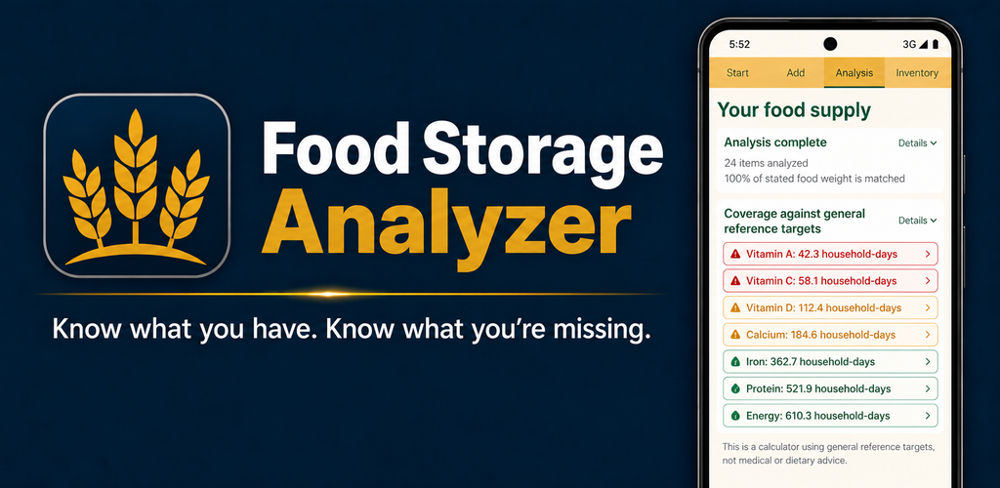
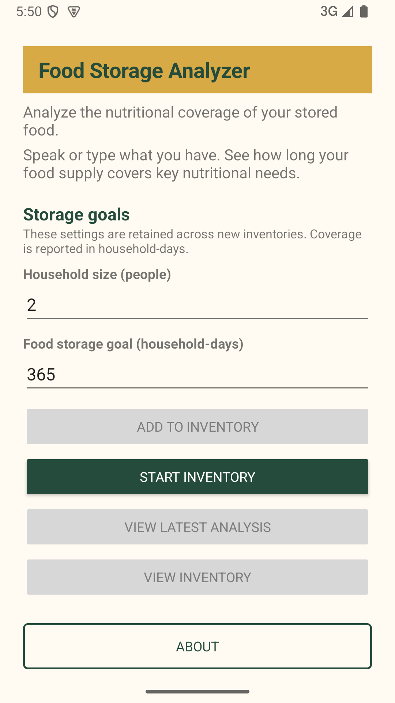
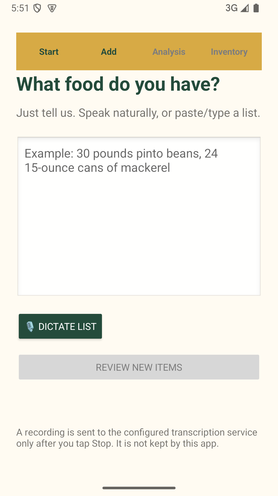
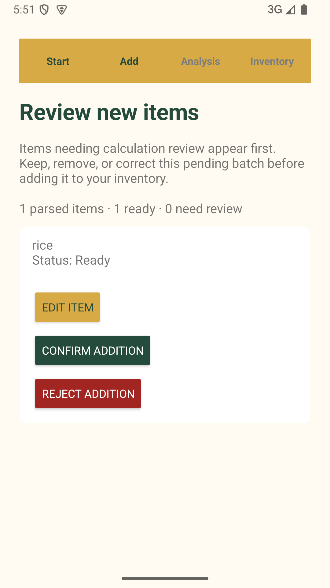
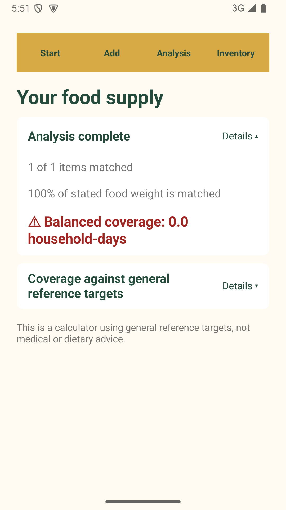
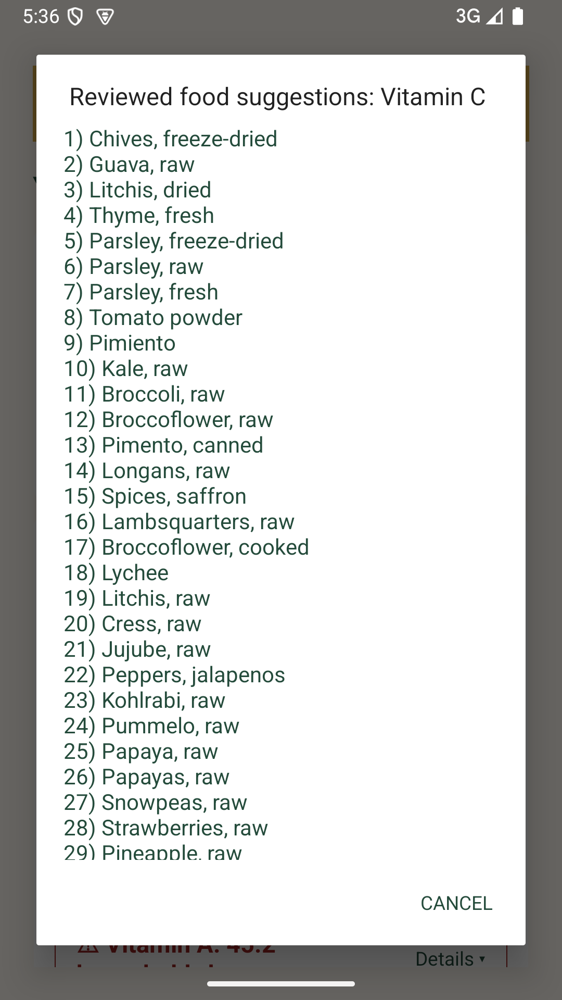
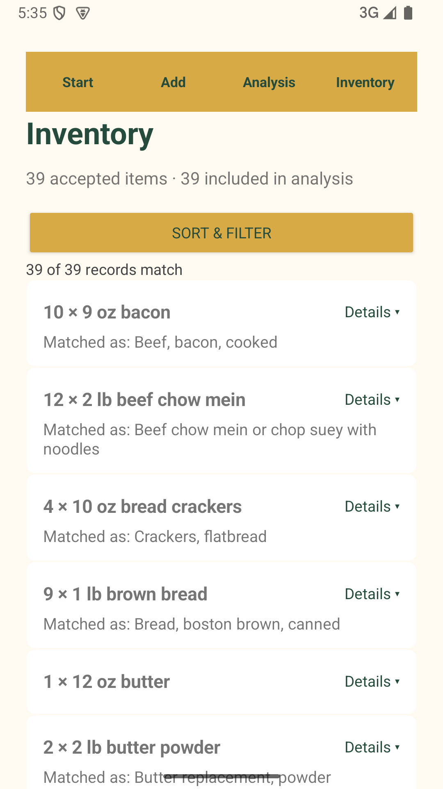

# Food Storage Analyzer

**Status:** 🟢 Production
**Current version:** `2026.10.13-3`

## Analyze your emergency food supply without building a spreadsheet

Food Storage Analyzer (FSA) lets you speak, paste, or type your stored-food
inventory in plain language. FSA turns that input into an organized list,
matches foods against USDA nutrition data, and estimates how long the supply
can support your household.

Instead of spending hours building a food-storage spreadsheet, describe what
you have&mdash;such as &ldquo;30 pounds of pinto beans,&rdquo; &ldquo;24 15-ounce cans of
mackerel,&rdquo; or &ldquo;six cans of oysters&rdquo;&mdash;then review and correct what FSA
understood before analysis.

FSA evaluates nutritional coverage in household-days, identifies nutrients
that limit the overall food supply, and suggests additions that may address
identified nutritional deficiencies. USDA nutrition data covering thousands of
foods and products allows FSA to handle inventories containing both common
staples and less common foods.

When a food match is uncertain or nutritional information is incomplete, FSA
identifies the item for review rather than treating uncertain information as
fact. Inventory and analysis state are stored locally on the Android device.

## Features

- Speak, paste, or type a food inventory in plain language
- Build a structured inventory without manually creating a spreadsheet
- Match inventory items against USDA nutrition data covering thousands of foods and products
- Review and correct recognized inventory items before analysis
- Set household size and food-storage goals
- Estimate balanced nutritional coverage in household-days
- Show coverage for individual nutrients
- Identify nutrients that limit overall coverage
- Suggest additions that may address identified nutritional deficiencies
- Flag uncertain matches and incomplete nutritional information for review
- Sort and filter the stored inventory
- Store inventory and analysis state locally on the Android device
- No account or registration required

## Screenshots

  
  
  
  
  
  

## Repository Purpose

This public repository contains Food Storage Analyzer documentation, release
notes, store graphics, screenshots, and issue-tracking material. It does not
contain the Android application source code.

## Resources

- [Release Notes](docs/release-notes.md)
- [Documentation](docs/README.md)
- [Google Play](https://play.google.com/store/apps/details?id=champagne.engineering.fsa)
- [Food Storage Analyzer product page](https://champagne.engineering/food-storage-analyzer)
- [Privacy Policy](https://champagne.engineering/privacy)
- [Terms of Service](https://champagne.engineering/tos)

## Support

Website: https://champagne.engineering 
Email: support@champagne.engineering

## Important Notice

Food Storage Analyzer provides informational calculations and estimates. It
does not provide medical, nutritional, dietary, emergency-preparedness, or
other professional advice. Results may be incomplete or inaccurate and should
not be the sole basis for decisions affecting health, nutrition, or emergency
preparedness.

## Copyright

© 2026 Champagne Engineering, LLC. All rights reserved.

Food Storage Analyzer is an independent application developed under the CE
Widgets brand by Champagne Engineering, LLC.
